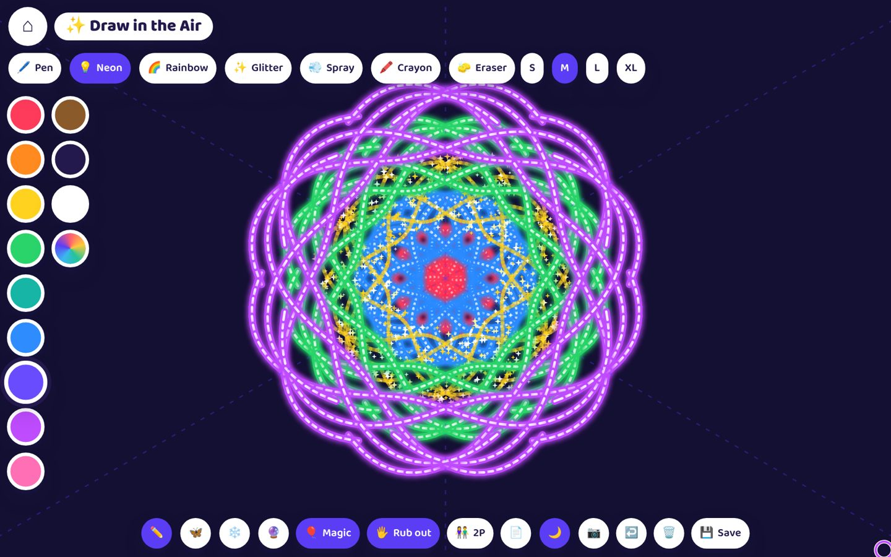
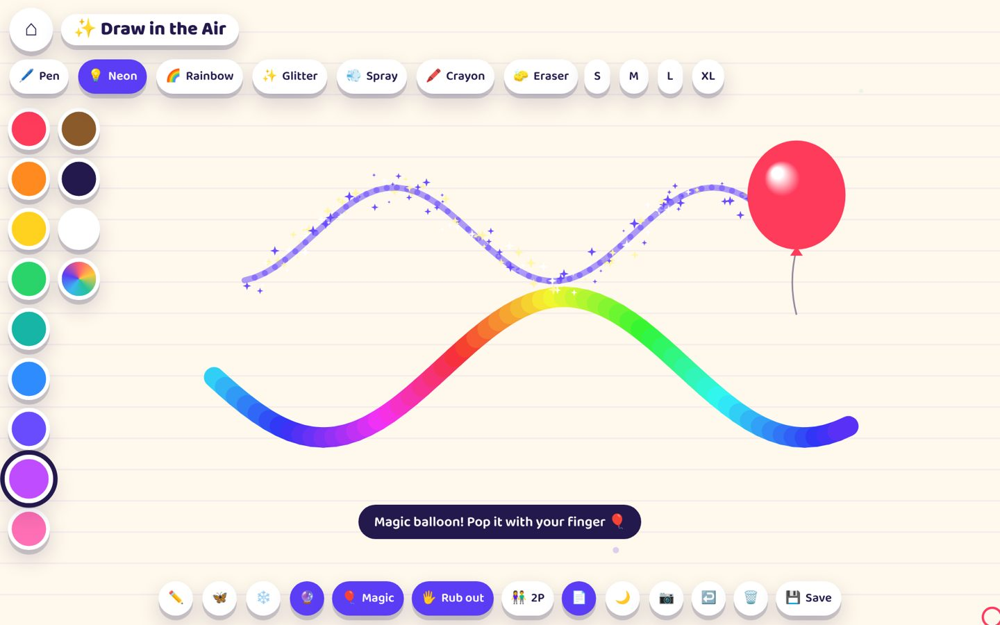
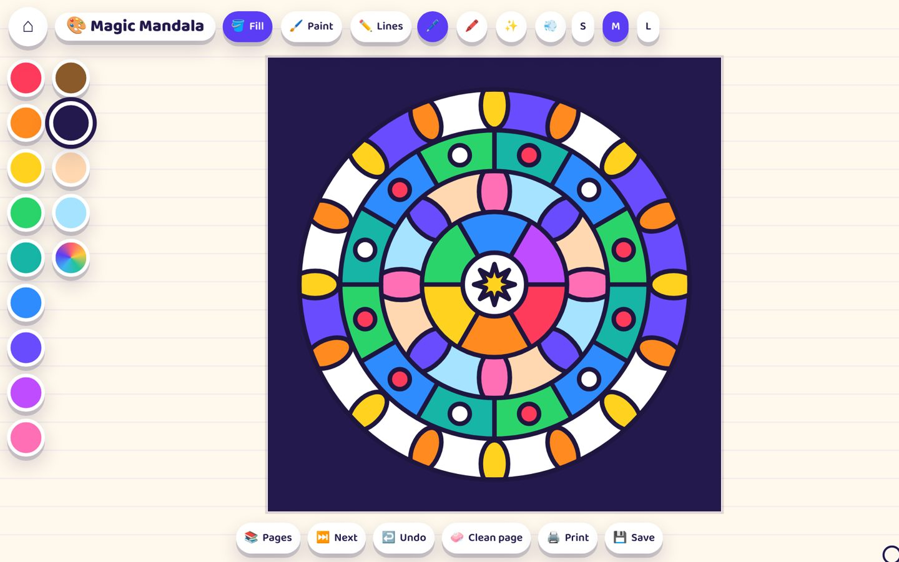
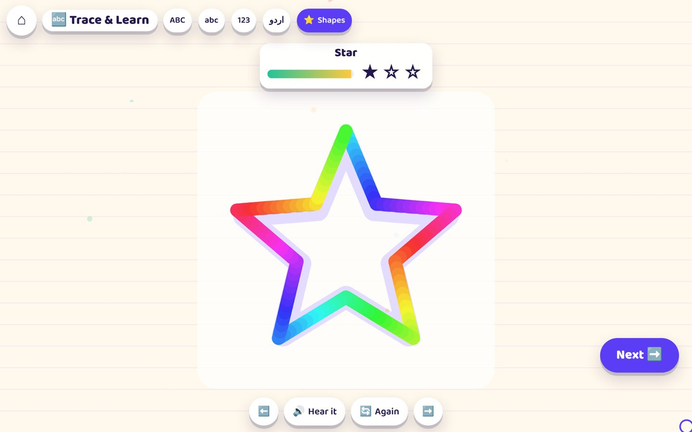
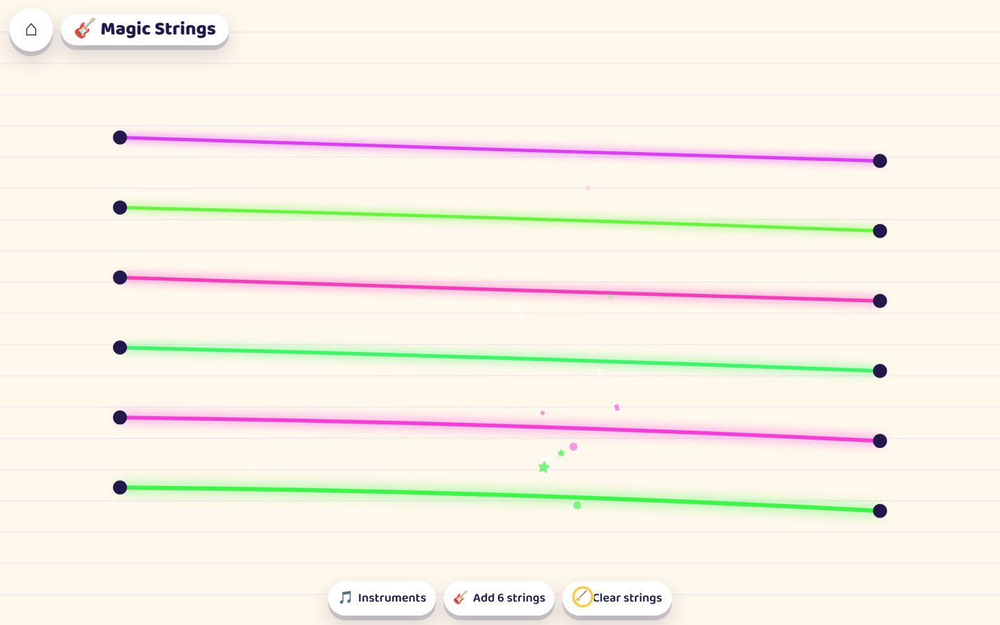
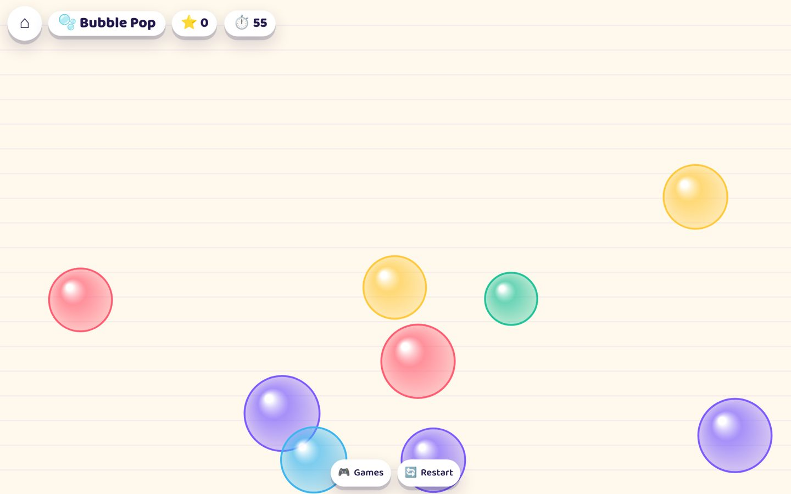
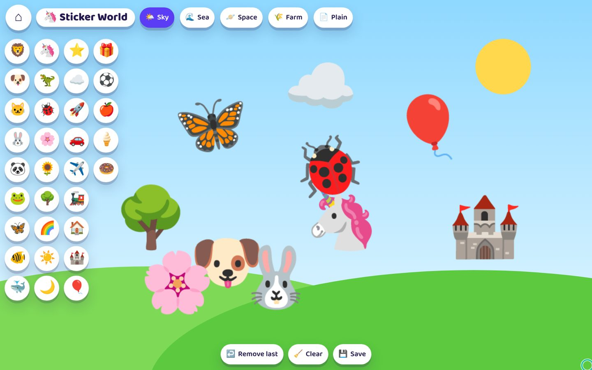
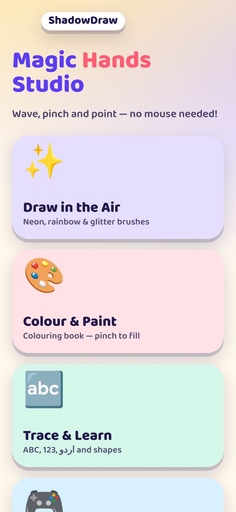
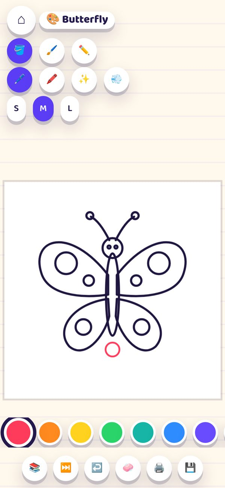

<div align="center">


# ShadowDraw — Magic Hands Studio

**Draw, colour, trace letters, play games and make music by moving your hands in front of the webcam.**<br>
No mouse, no stylus, no extra gear. Built for kids. Works offline.

### [▶ Try it in your browser](https://shadowdraw.vercel.app) &nbsp;·&nbsp; [⬇ Download for Windows](https://github.com/mrchhan/shadowdraw/releases/latest)



</div>

---

## ✨ What kids can do

| | |
|---|---|
|  | <h3>✨ Draw in the Air</h3>Pinch your thumb and pointer finger to draw. Choose from 7 brushes (pen, neon, rainbow, glitter, spray, crayon and eraser) and 4 sizes. Turn on **Mirror**, **4-way** or **Kaleidoscope** for symmetric art. Draw a circle and it **turns into a balloon** you can pop. An open hand rubs out. **2-player** split screen. |
|  | <h3>🎨 Colour & Paint</h3>12 colouring pages: fish, house, flower, butterfly, car, rocket, kitty, apple tree, ice cream, turtle, mandala and rainbow. **Pinch inside a shape to fill it**, including a rainbow fill. You can also paint with brushes, draw your own page, print blank pages, and turn any saved drawing into a colouring page. |
|  | <h3>🔤 Trace & Learn</h3>Trace **ABC, abc, 123, Urdu letters (اردو)** and **shapes**. A progress bar fills as you go, and you earn 1–3 stars. Letters are read out ("A is for Apple"). |
|  | <h3>🎵 Air Music</h3>**Magic Strings:** pinch with both hands to stretch a guitar string, let go to pin it, then swipe across to play. **Air piano** with Do-Re-Mi colours and 3 guided songs, **8 drum pads**, and a **theremin** ("Wavy Sound"). All the sound is made in the app, so it works offline. |
|  | <h3>🎮 Air Games</h3>**Bubble Pop**, **Star Catch**, **Letter Hunt** (pop the letter that's called out) and **Fruit Swipe**. 60-second rounds with scores and stars. |
|  | <h3>🦄 Sticker World</h3>32 stickers on 5 backgrounds. Pinch to grab, **use two hands to grow and spin** a sticker, and drop it on the bin to remove it. |

Also included:
- 🖼️ **Gallery** to save art, download, print, ▶ **replay a drawing as a time-lapse**, and 🎬 **export it as a video**
- 🗣️ Spoken praise in English and Urdu ("Shabash!", "Zabardast!") with confetti
- ⚙️ **Grown-ups area** behind a maths question:
  - screen-time limit
  - camera choice, mirror view and how much camera shows
  - pinch or point to draw
  - sensitivity, smoothing, reach and hover-click time
  - left-handed layout, sounds, voice and tracking quality

## ✋ Hand controls

| Gesture | Does |
|---|---|
| 🤏 **Pinch** (thumb + pointer finger) | Draw, click, grab |
| ✋ **Hold your hand over a button** for 1 second | Press it (a ring fills up) |
| 🖐️ **Open hand** | Rub out (in Draw) |
| 🤏🤏 **Two hands** | Make guitar strings, grow and spin stickers, 2-player drawing |
| 👆 **Touch / mouse** | Works everywhere too. On a tablet, two fingers act as two hands |

## 📱 Works everywhere

 

- **Browser:** Chrome, Edge, Safari or Firefox on a laptop, tablet or phone
- **Install as an app:** browser menu → *Install app*, or *Share → Add to Home Screen* on iPhone. After the first visit **everything works offline**, including the hand-tracking model
- **Windows:** installer or portable `.exe` from [Releases](https://github.com/mrchhan/shadowdraw/releases/latest)

## 🔒 Privacy

The camera picture is processed **only on the device** by [MediaPipe Hands](https://github.com/google/mediapipe). Nothing is uploaded, and there are no accounts, ads or tracking. Saved pictures stay in the browser on that device.

---

## 🛠 For developers

### Run locally
The camera needs `https://` or `localhost`, so serve the folder instead of opening the file directly:
```bash
git clone https://github.com/mrchhan/shadowdraw.git
cd shadowdraw
npx http-server -p 8080 -c-1 .     # or: python -m http.server 8080
```
Open <http://localhost:8080>.

### Deploy
It's a plain static site with no build step. Import the repo into Vercel (Framework: **Other**) or Netlify, or turn on GitHub Pages.
After changing any file, raise `VERSION` in `sw.js` so installed copies update.

### Build the Windows app
Needs [Node.js](https://nodejs.org) 18+. Run on Windows:
```bash
cd desktop
npm install
npm start        # run the desktop app
npm run dist     # build installer + portable .exe in desktop/dist
```
`npm run dist:mac` and `npm run dist:linux` are also available.

### Project layout
```
index.html, css/app.css       app shell and styles
js/tracker.js                 camera, MediaPipe Hands, gestures, smoothing, touch fallback
js/ui.js                      hover-to-click, cursors, dialogs, parent gate, screen time
js/audio.js                   sound effects, guitar/piano/drum synths, spoken praise
js/pages.js                   colouring-book line art (1000×1000 SVG paths)
js/modes/*.js                 one file per mode
vendor/mediapipe-hands/       MediaPipe Hands, bundled for offline use
vendor/fonts/                 Baloo 2 + Noto Naskh Arabic
sw.js, manifest.webmanifest   offline cache and install
desktop/                      Electron wrapper for the Windows/macOS/Linux app
docs/screenshots/             images used in this README
```

**Add a colouring page:** add an entry to `SD.PAGES` in `js/pages.js`, using SVG path strings, circles `{c:[x,y,r]}`, ellipses `{e:[x,y,rx,ry,rot]}` or stars `{star:[x,y,r,points]}`.

## 🙏 Credits
- Hand tracking: [MediaPipe Hands](https://github.com/google/mediapipe) by Google (Apache-2.0)
- Fonts: [Baloo 2](https://fonts.google.com/specimen/Baloo+2) and [Noto Naskh Arabic](https://fonts.google.com/noto/specimen/Noto+Naskh+Arabic) (SIL Open Font License)

---

<div align="center">

Made with ❤️ by **Shadow Creative Studio**<br>
© 2026 Shadow Creative Studio. All rights reserved.

</div>
